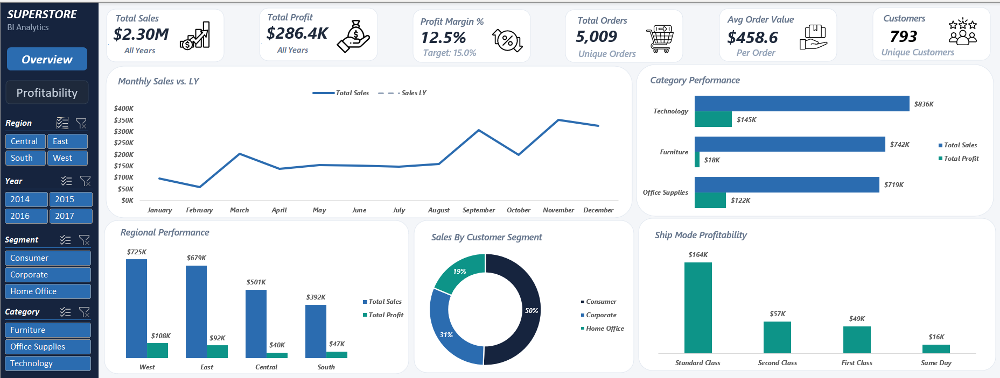
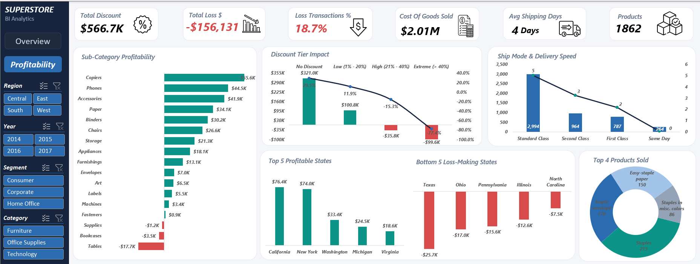

# Superstore Executive Sales & Profitability Analytics


An end-to-end Business Intelligence solution built with **SQL Server** and **Microsoft Excel (Power Query, Power Pivot, and DAX)**. Designed with a modern **Bento-Grid, Power BI-inspired UI**, this two-page executive dashboard diagnoses revenue trends, margin erosion, discount elasticity, and regional profitability across **4 years of retail operations (2014–2017)**.

---

## Executive Summary

Between 2014 and 2017, Superstore generated **$2.30M in revenue** across **5,009 unique orders** and **793 customers**, yielding **$286.4K in net profit**—a **12.5% overall profit margin**, falling **2.5 percentage points short of the 15.0% target**.

Diagnostic analysis reveals that profitability is not constrained by demand, but by **aggressive discounting and localized cost leakage**:
* **$566.7K in revenue** was given away as discounts, directly contributing to **$156.1K in gross losses** across **18.7% of all order lines**.
* Discounts exceeding **20%** flip transactions deeply negative, eroding **-$135.4K** in profit across High (21%–40%) and Extreme (>40%) discount tiers.
* **Furniture** contributes 32% of sales (**$742K**) yet delivers only **$18K in profit (2.4% margin)**, dragged down by **Tables (-$17.7K)** and **Bookcases (-$3.5K)**.

---

## Dashboard Preview

### Page 1: Executive Overview
Tracks high-level commercial health, YoY monthly seasonality, category/regional performance, customer segment mix, and shipping mode profitability.



### Page 2: Profitability & Operational Diagnostics
Isolates margin leaks across all 17 sub-categories, discount tiers, top/bottom performing states, delivery speeds, loss distribution by customer segment.



## Data Architecture & Engineering

Raw transactional data (`Staging_Superstore`) was transformed in **SQL Server (SSMS 21)** into a normalized **Star Schema** via modular SQL Views, then loaded into Excel's **Power Pivot Data Model**.

```text
                       ┌──────────────────┐
                       │     Date_Dim     │
                       │  (2014 - 2017)   │
                       └────────┬─────────┘
                                │ 1:*
┌──────────────────┐   1:*  ┌───┴──────────────┐  *:1   ┌──────────────────┐
│   Products_Dim   ├────────┤   Fact_Orders    ├────────┤   Location_Dim   │
└──────────────────┘        │ (Sales, Profit,  │        └──────────────────┘
                            │  COGS, Discount) │
                            └───┬──────────────┘
                                │ *:1
                       ┌────────┴─────────┐
                       │  Customers_Dim   │
                       └──────────────────┘
```

### Key Engineering Decisions
1. **Deterministic Surrogate Keys:** Resolved a classic SQL View key-misalignment pitfall by ordering `ROW_NUMBER()` over full composite natural keys (`ORDER BY Region, State, City` in `Location_Dim` and `ORDER BY Product_ID, Product_Name` in `Products_Dim`), guaranteeing 100% consistent joins between views on every refresh.
2. **Full-Year Tally Calendar (`Date_Dim`):** Built a non-recursive tally-table calendar spanning complete calendar years (`2014-01-01` to `2017-12-31`) using `DATEFROMPARTS`, enabling accurate DAX Time Intelligence (`SAMEPERIODLASTYEAR`) while eliminating empty 2018 slicer artifacts caused by late-December shipping dates.
3. **Pre-Calculated Analytical Columns:** Computed `COGS (Sales - Profit)`, `Original_Price (Sales / (1 - Discount))`, and `Shipping_Days (DATEDIFF)` at the SQL view layer to keep the Power Pivot model lightweight and fast.

---

## Core KPIs & DAX Measures

| Metric | Value (All Years) | Definition / DAX Logic |
| :--- | :--- | :--- |
| **Total Sales** | `$2.30M` | `SUM(Fact_Orders[Sales])` |
| **Total Profit** | `$286.4K` | `SUM(Fact_Orders[Profit])` |
| **Profit Margin %** | `12.5%` | `DIVIDE([Total Profit], [Total Sales])` *(Target: 15.0%)* |
| **Total Orders** | `5,009` | `DISTINCTCOUNT(Fact_Orders[Order_ID])` |
| **Avg Order Value (AOV)** | `$458.6` | `DIVIDE([Total Sales], [Total Orders])` |
| **Total Discount $** | `$566.7K` | `SUMX(Fact_Orders, Fact_Orders[Original_Price] - Fact_Orders[Sales])` |
| **Total Loss $** | `-$156.1K` | `CALCULATE([Total Profit], Fact_Orders[Profit] < 0)` |
| **Loss Transactions %** | `18.7%` | `DIVIDE(COUNTROWS(FILTER(Fact_Orders, Profit < 0)), COUNTROWS(Fact_Orders))` |
| **Cost of Goods (COGS)** | `$2.01M` | `SUM(Fact_Orders[COGS])` |
| **Avg Shipping Days** | `4.0 Days` | `AVERAGE(Fact_Orders[Shipping_Days])` |

---

## Key Business Insights

### 1. The Discounting Cliff (Primary Profit Drain)
* **No Discount** orders generate **+$321.0K in profit** at a healthy **29.5% margin**.
* **Low Discounts (1%–20%)** remain profitable (**+$100.8K**, **11.9% margin**).
* Crossing the **20% threshold** destroys unit economics: **High Discounts (21%–40%)** drop to **-15.3% margin (-$35.8K)**, and **Extreme Discounts (>40%)** collapse to **-77.4% margin (-$99.6K)**.

### 2. Category Imbalance: High Volume, Low Margin in Furniture
* **Technology** (`$836K` sales, `$145K` profit, **~17.3% margin**) and **Office Supplies** (`$719K` sales, `$122K` profit, **~17.0% margin**) drive 93% of total company profit.
* **Furniture** (`$742K` sales) generates just **`$18K` profit (2.4% margin)**. Out of 17 sub-categories, only 3 lose money—and two are in Furniture: **Tables (`-$17.7K`)**, **Bookcases (`-$3.5K`)**, alongside **Supplies (`-$1.2K`)**.
* Top profit engines are **Copiers (`$55.6K`)**, **Phones (`$44.5K`)**, and **Accessories (`$41.9K`)**.

### 3. Geographic Concentration of Profit & Loss
* **West (`$108K` profit, ~14.9% margin)** and **East (`$92K` profit, ~13.5% margin)** lead performance, anchored by **California (`$76.4K`)** and **New York (`$74.0K`)**.
* **Central** is the weakest region (**~8.0% margin**, `$40K` profit on `$501K` sales).
* Just **5 states** account for **`-$78.4K` in net losses**: **Texas (`-$25.7K`)**, **Ohio (`-$17.0K`)**, **Pennsylvania (`-$15.6K`)**, **Illinois (`-$12.6K`)**, and **North Carolina (`-$7.5K`)**.

### 4. Seasonality, Segments & Fulfillment Mix
* **Q4 Seasonality:** Sales surge from **September (~$308K)** through **December**, peaking in **November (~$350K)**, while **February (~$60K)** is the slowest month.
* **Customer Mix:** **Consumer** represents **50%** of sales, followed by **Corporate (31%)** and **Home Office (19%)**.
* **Shipping:** **Standard Class** handles **59.8% of orders (2,994)** and generates **$164K** in profit with a ~5-day delivery cycle; overall fulfillment averages **4.0 days**.

---

## Strategic Recommendations

1. **Enforce a 20% Discount Cap:** Establish a hard pricing guardrail capping standard promotional discounts at 20%, requiring regional director approval above that tier. Eliminating or restructuring High/Extreme discount orders directly addresses **$135.4K in profit leakage** and can push overall margin past the **15.0% target**.
2. **Restructure Furniture Pricing & Logistics:** Audit freight costs and vendor pricing on **Tables** and **Bookcases**; consider bundling low-margin furniture items with high-margin accessories or introducing minimum-margin rules.
3. **Regional Pricing Audit (Top 5 Loss States):** Conduct a targeted review of promotional policies in **Texas, Ohio, Pennsylvania, Illinois, and North Carolina** (particularly within the Central region) where heavy discounting is subsidizing unprofitable orders.
4. **Proactive Q4 Inventory & Fulfillment Planning:** Allocate working capital and Standard Class logistics capacity ahead of the **September–November peak** while expanding **Copiers, Phones, and Accessories** promotions to maximize margin capture.

---

## How to Use
1. Clone this repository or download `Superstore_Executive_Dashboard.xlsx`.
2. Open in **Microsoft Excel (2016 or later / Microsoft 365)** — all Pivot Tables, Power Pivot Data Model tables, and interactive slicers work offline with no database connection required.
3. To reproduce the backend SQL pipeline, load the Superstore dataset into a table named `Staging_Superstore` in SQL Server and execute the view scripts inside the `/sql` folder in order.
